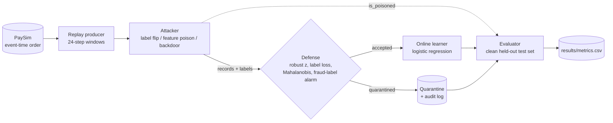

# Poisoning and Robustness in Streaming Classifiers

A streaming fraud classifier that learns from a live transaction stream, an attacker that poisons the stream
(label flips, feature poisoning, backdoor), and a defense that scores every incoming record, quarantines the
suspicious ones before the learner sees them, and logs every decision.

Course project for Big Data Systems and Responsible AI. Public or synthetic data only (PaySim).
We compare three conditions: **no attack**, **attack**, **attack with defense**.

## Headline results

PR-AUC on a clean held-out test set (PaySim 10% sample, 3 attack seeds, mean). Details: [`notebooks/defense_results.ipynb`](notebooks/defense_results.ipynb).

| Attack (budget 0.2) | No defense | With defense |
|---|---|---|
| none (baseline) | 0.998 | 0.987 |
| random label flip, uniform | 0.22 | 0.96 |
| random label flip, low-and-slow | 0.02 | 0.97 |
| feature noise, uniform | 0.42 | 0.99 |
| feature noise, low-and-slow | 0.64 | 0.99 |
| every other attack/timing pair | 0.99 to 1.00 | 0.99 |

- Detection recall: feature shift 1.00, targeted flip 0.99, random flip 0.94, feature noise 0.86, backdoor 0.63, **feature scale 0.04 (blind spot)**.
- The defense costs about 0.011 PR-AUC when nothing is wrong, and quarantines 0.04% of clean records and about 4.5% of real frauds.
- Caveats (read before quoting): three seeds share one clean sample, thresholds were tuned on that sample, and no adaptive attacker was tested. See the limitations in the [model and data card](docs/model_data_card.md).

## Architecture



The ground truth `is_poisoned` goes only to the evaluator; the defense never receives it (a unit test enforces this).
The offline loop (single process) and the Kafka consumers run the same `prepare_run` / `StreamRun` code, so they
can only differ by transport.

## Quick start

Verified on Windows with Python 3.14.6: 265 tests pass, the results notebook executes,
and Kafka matches offline on a random-flip attack with defense enabled.
`requirements-lock.txt` records the tested dependency versions.

```bash
git clone https://github.com/tanvishetty1403/streaming-poisoning-robustness.git
cd streaming-poisoning-robustness
python3.11 -m venv .venv && source .venv/bin/activate      # Windows: py -3.11 -m venv .venv ; .venv\Scripts\Activate.ps1
pip install -r requirements.txt
python -m pytest -q                                         # 265 tests
```

### Data
1. Kaggle > Settings > Create New Token, save `kaggle.json` to `~/.kaggle/kaggle.json` (Windows: `C:\Users\<you>\.kaggle\kaggle.json`).
2. `bash scripts/download_data.sh` (Windows: `powershell -ExecutionPolicy Bypass -File scripts\download_data.ps1`) downloads PaySim and ULB into `data/raw/`.
3. `python scripts/make_attacked_sample.py --input data/raw/paysim.csv` builds the 10% sample (`stream_clean`, `test_clean`).

Raw data is never committed. Check each dataset's licence on its Kaggle page.

### Run one experiment
```bash
python -m src.pipeline.run_offline --dataset paysim --attack none --defense off
python -m src.pipeline.run_offline --dataset paysim --attack random_flip --budget 0.2 --timing uniform --defense on
```
Attacks: `random_flip`, `targeted_flip`, `feature_shift`, `feature_scale`, `feature_noise`, `backdoor`.
Timings: `uniform`, `burst`, `low_and_slow`. Rows are appended to `results/metrics.csv`.

### Reproduce the results (3 seeds, defense off and on)
```bash
python scripts/extend_attacked_samples.py --seeds 0 1 2            # attacked files for every seed
python -m src.attacks.sweep --clean-dir data/attacked_sample       # results/metrics.csv (resumable)
bash scripts/run_multiseed.sh                                      # detection, clean-record loss, subgroups
bash scripts/run_ablation.sh                                       # detector ablation (budget 0.2)
python scripts/collect_results.py                                  # results/summary/*.csv (committed)
python scripts/build_notebook.py                                   # notebooks/defense_results.ipynb
```
The notebook reads only `results/summary/*.csv`, so it re-runs without the 600 MB attacked samples.

To rebuild and execute the notebook after installing `requirements.txt`:
```bash
python scripts/build_notebook.py
```

### Verify Kafka against offline on an attacked stream

Start Docker Desktop's engine, then run from the repository root (Windows CMD):
```bat
docker compose -f docker/docker-compose.yml up -d
docker compose -f docker/docker-compose.yml exec kafka /opt/kafka/bin/kafka-topics.sh --bootstrap-server 127.0.0.1:9092 --list
.venv\Scripts\python.exe -m src.pipeline.kafka_stream --dataset paysim --attack random_flip --budget 0.2 --timing uniform --defense on --clean-dir data/attacked_sample --check --out results/verification/kafka_metrics.csv
```
If the broker readiness command fails during startup, wait briefly and repeat it before starting Python.
The saved clean sample must already exist; create it with the data steps above.
Success prints `KAFKA MATCHES OFFLINE`. A mismatch raises an error and does not append metrics.
The verification CSV is separate from the main experiment grid. To stop the broker afterward:
```bat
docker compose -f docker/docker-compose.yml down
```

### Kafka
`docker compose -f docker/docker-compose.yml up -d` starts a single-node Kafka (3 partitions);
`src/pipeline/kafka_stream.py` runs the partitioned consumers; `run_all.sh` chains setup and a check run.

## The defense in one table

| Part | What it does |
|---|---|
| Robust z-score | Median/MAD against a rolling reference of accepted rows with the same label |
| Label consistency | Class-balanced logistic model; flags rows whose given label is very unlikely |
| Mahalanobis | Class-conditional, shrunk covariance; catches jointly odd feature combinations |
| Ensemble | Scores divided by each detector's threshold; quarantine when the maximum exceeds 1 |
| Fraud-label alarm | Poisson test on the fraud-label count per window; freezes the fraud-class reference during a flood |
| Mass-flag guard | Accepts a window's legit-labelled rows when more than 15% are flagged by feature detectors alone (stale reference) |
| Trusted warm-up | Window 0 is accepted unchecked and only builds the references |

All thresholds live in the `defense:` section of [`config/default.yaml`](config/default.yaml).

## Repository layout

| Path | Contents |
|---|---|
| `contracts/CONTRACTS.md` | Interfaces every module follows (record schema, `apply_attack`, `defend`, metrics CSV) |
| `config/default.yaml` | All settings (datasets, learner, attacks, defense, seeds) |
| `src/pipeline/` | Replay, online learner, metrics, offline loop, Kafka stream (P1) |
| `src/attacks/` | Attacks, adapter, sweep runner (P2) |
| `src/defense/` | Detectors, ensemble, drift alarm, quarantine, audit log (P3) |
| `scripts/` | Data download, attacked-sample builders, tuning, multi-seed and ablation runners, notebook builder |
| `notebooks/defense_results.ipynb` | Results notebook (figures regenerate from `results/summary/`) |
| `results/summary/` | Committed summary CSVs behind the notebook |
| `docs/` | Model and data card, defense section of the report |
| `tests/` | Attack, defense, harness and leakage tests |
| `docker/` | Kafka via Docker Compose |

## Documents
- [Model and data card](docs/model_data_card.md): intended use, data, results, fairness, limitations.
- [Defense section of the report](docs/report_defense_section.md).
- [Contracts](contracts/CONTRACTS.md).

## Team
P1: pipeline and systems. P2: attacks and experiments. P3: defense and responsible AI.
No contract change without all three agreeing.
